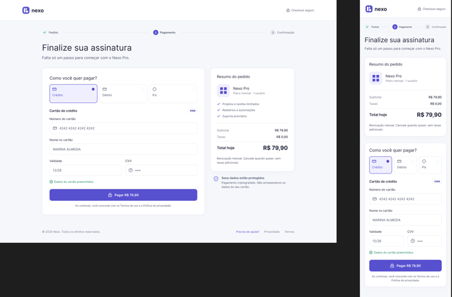
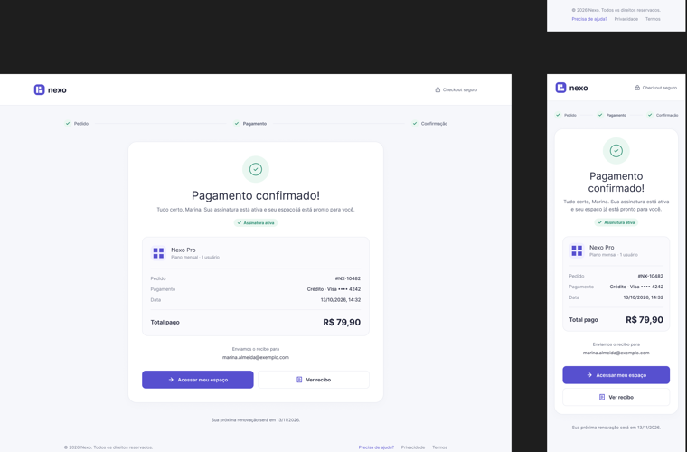
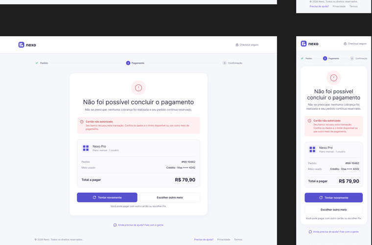
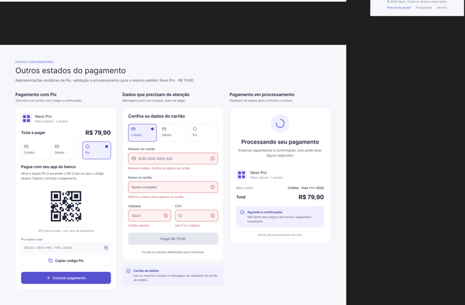
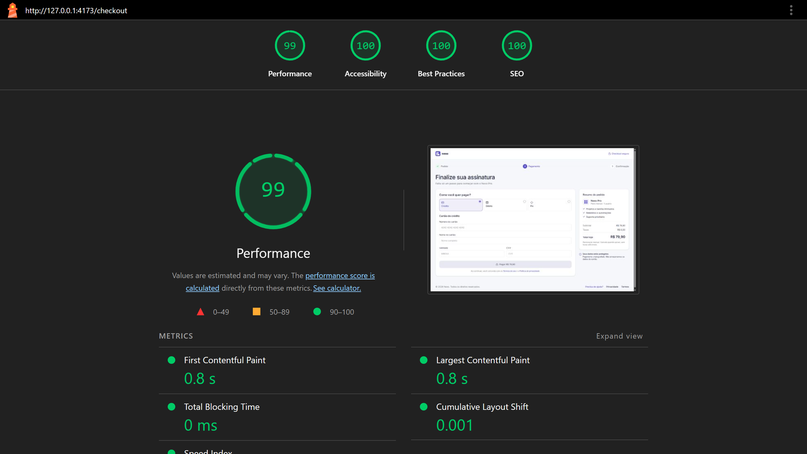
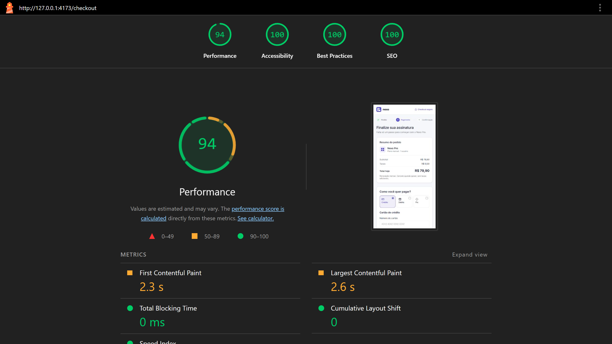

# Nexo Pro — Checkout

Checkout frontend da **Nexo** para o plano **Nexo Pro** (mensal, 1 usuário, R$ 79,90).  
Angular 22 · Tailwind CSS 4 · crédito, débito e Pix simulados no navegador.



Referência visual — pagamento com crédito (desktop e mobile)

## Visão geral

O objetivo é um funil de checkout responsivo, com validação de cartão, três meios de pagamento simulados e telas de resultado. O estado do funil vive no em memória. O pagamento é deliberadamente simulado: não há gateway, backend nem cobrança real.

## Stack

Versões confirmadas no `package.json`:

- Angular 22.2 (`@angular/core` ^22.2.0, CLI ^22.2.4)
- TypeScript ~6.0.2
- Tailwind CSS 4.3.3
- Angular Router
- Signal Forms (`@angular/forms/signals`)
- Angular Signals
- Lucide (`@lucide/angular` ^1.61.0)

Não há NgRx, Bootstrap, kit de UI, backend nem pasta de interfaces. O Prettier (^3.8.1) entra só como formatação.

## Arquitetura

`src/app` usa camadas típicas de uma aplicação Angular, com aliases `@core/*`, `@shared/*`, `@layout/*` e `@features/*`:

```text
src/app/
  core/          catálogo Nexo Pro, PaymentSimulator, checkoutResultGuard
  shared/        CheckoutSnapshot e util de cartão (Luhn, bandeira, máscaras)
  layout/guest/  header e footer do funil de conversão
  features/checkout/
                 CheckoutStore, pagamento, sucesso, erro e UI do funil
```

- `core/` — borda da aplicação: catálogo do produto (`nexo-pro.ts`), o `PaymentSimulator` no lugar de um gateway e o `checkoutResultGuard`.
- `shared/` — contrato (`CheckoutSnapshot`) e util de cartão, para a feature importar sem copiar regra.
- `layout/` — chrome do funil guest (`Guest`, header e footer). Não é o shell logado do produto.
- `features/checkout/` — telas e o estado do funil. O stepper fica no host `Checkout`. Pagamento, sucesso e erro são rotas filhas.

`CheckoutStore` guarda o snapshot em memória (`idle | processing | success | error`) e expõe `asReadonly()`. Só muda por métodos (`selectMethod`, `payWithCard`, `payWithPix`, `retry`, `chooseOtherMethod`). Não conhece o Router.

`PaymentSimulator` aplica o atraso de ~3.000 ms (`Promise` + `setTimeout`) e a regra determinística do cartão. Não conhece o snapshot.

```text
UI  →  CheckoutStore  →  PaymentSimulator
              │
              ▼
         /checkout  (idle | processing)
              │
              ├── status success → /checkout/success
              └── status error   → /checkout/error
```

Detalhes em [`docs/architecture.md`](docs/architecture.md).

## Fluxo da aplicação

| Rota | Comportamento |
| --- | --- |
| `/` | Redireciona para `/checkout`. |
| `/checkout` | Pagamento: resumo, meios, formulário ou Pix, e o painel de processamento. |
| `/checkout/success` | Resultado aprovado. Exige `status === 'success'` em memória (`CanActivate`). |
| `/checkout/error` | Resultado recusado. Exige `status === 'error'` em memória (`CanActivate`). |

O passo **Pedido** do indicador de etapas não é rota. Pagamento e erro usam o passo Pagamento; sucesso usa Confirmação.

1. **Entrada.** `/` redireciona para `/checkout`. O meio inicial é **crédito**; os campos começam vazios.
2. **Método.** Crédito, débito ou Pix. Crédito e débito compartilham o mesmo formulário, as mesmas validações e os mesmos cartões de teste. Débito só troca o título do fieldset para “Cartão de débito”.
3. **Preenchimento e validação.** Signal Forms no cartão. O botão **Pagar R$ 79,90** permanece desabilitado enquanto o formulário for inválido.
4. **Processamento.** Na própria `/checkout` (“Processando seu pagamento”, ~3.000 ms). Não existe rota de processamento. Envios duplicados são ignorados (`status !== 'idle'`).
5. **Aprovação ou recusa.** Após o atraso, a aplicação navega para `/checkout/success` ou `/checkout/error`.
6. **Pix.** QR Code estático (`pix-qr.svg`), código copia e cola `000201.NEXO-PRO.7990.DEMO`, **Copiar código Pix** (`navigator.clipboard`, com mensagem se a cópia falhar) e **Concluir pagamento**. A simulação só começa depois dessa confirmação e sempre aprova.
7. **Sucesso.** Resumo da tentativa em memória. **Acessar meu espaço** e **Ver recibo** não abrem rota nova: avisos locais deixam explícito que espaço e recibo são simulados.
8. **Erro.** Motivo “Cartão não autorizado”. **Tentar novamente** volta a `/checkout` com o mesmo meio e campos vazios. **Escolher outro meio** volta a `/checkout` sem meio selecionado.
9. **Proteção das rotas de resultado.** `checkoutResultGuard` (`CanActivate`) exige o status correspondente no `CheckoutStore`. Acesso direto, refresh ou URL sem esse estado redireciona para `/checkout`.



Referência visual — sucesso (desktop e mobile)



Referência visual — recusa (desktop e mobile)

## Validações

Implementadas em `card.schema.ts` (Signal Forms) e `shared/utils/card.ts`. Crédito e débito usam as mesmas regras.

| Campo | Regra | Mensagem |
| --- | --- | --- |
| Número | Luhn; Visa (inicia em `4`) ou Mastercard (`51–55` ou `2221–2720`) | Número inválido. Confira os dígitos do cartão. |
| Nome | Obrigatório; pelo menos duas palavras | Informe o nome como aparece no cartão. / Nome incompleto |
| Validade | `MM/AA` e não vencida | Cartão vencido. |
| CVV | 3 ou 4 dígitos | Use 3 ou 4 dígitos. |
| Formulário | Envio bloqueado se inválido | Corrija os campos destacados para continuar. |

Estados do funil: `idle`, `processing`, `success`, `error`. Com o cartão válido, o formulário exibe “Dados do cartão preenchidos”. Número fora das bandeiras suportadas é inválido mesmo com Luhn correto.



Referência visual — Pix, validação e processamento

## Simulação de pagamento

Não há gateway real nem backend de pagamento. O `PaymentSimulator` (`src/app/core/services/payment-simulator.ts`) decide o resultado no cliente.

Cartões de teste determinísticos:

- `4242 4242 4242 4242` — aprovado (Visa).
- `4000 0000 0000 0002` — recusado, motivo “Cartão não autorizado”.
- Outros números válidos de Visa ou Mastercard — aprovados.
- Pix — aprovado após **Concluir pagamento**.

Use só esses dados fictícios. Não informe cartão real.

## Segurança e dados sensíveis

O número completo do cartão (PAN) e o CVV **não** são persistidos em:

- estado global (`CheckoutStore`);
- `localStorage` / `sessionStorage`;
- URL;
- logs.

Só informações necessárias ao fluxo ficam em memória: meio, bandeira, últimos 4 dígitos, valor, identificador `#NX-10482`, e-mail fictício e status. Recarregar a página descarta o estado. Esta documentação não afirma conformidade PCI DSS nem segurança de produção.

## Responsividade e acessibilidade

Cuidados realmente implementados:

- Layout desktop em duas colunas; no mobile, o resumo vem primeiro e o rodapé fica visível ao final da página, centralizado.
- HTML com `lang="pt-BR"`.
- Radios nativos para o meio de pagamento.
- Campos de cartão com `aria-invalid` e `aria-describedby` ligados à mensagem de erro.
- `role="alert"` nas mensagens de campo, no resumo do formulário e no banner de recusa.
- `role="status"` no painel de processamento (`aria-busy="true"`), na cópia do Pix e nos avisos da tela de sucesso.
- Stepper com `aria-label`, `aria-current="step"` e rótulos por etapa.
- Navegação por teclado nos controles nativos (radios, inputs, botões) e `focus-visible` nos campos.

A especificação pede revisão WCAG 2.2 AA; a matriz manual está em [`docs/specification.md`](docs/specification.md).

## Como executar

Pré-requisitos: Node.js 20.19+ ou 22.12+ (requisito do Angular 22) e npm.

Instale as dependências:

```bash
npm install
```

Inicie o servidor de desenvolvimento:

```bash
npm start
```

O script `start` executa `ng serve`. Acesse [http://localhost:4200](http://localhost:4200). A rota `/` redireciona para `/checkout`.

Também é possível usar `npx ng serve`.

Build de produção:

```bash
npm run build
```

O script `build` executa `ng build`. Em `angular.json`, a configuração padrão do build é `production`. A saída fica em `dist/angular-checkout-challenge`.

Também é possível usar `npx ng build`.

`npm test` e `tsconfig.spec.json` são resíduo do CLI e **não** fazem parte da validação deste desafio.

## Teste manual

As telas de referência estão em [`public/design/`](public/design/). A matriz completa (incluindo pixel-perfect e teclado) está na seção 9 de [`docs/specification.md`](docs/specification.md).

| Cenário | Comportamento esperado |
| --- | --- |
| Cartão aprovado | `4242 4242 4242 4242` → processamento em `/checkout` → `/checkout/success`. |
| Cartão recusado | `4000 0000 0000 0002` → `/checkout/error` com “Cartão não autorizado”. |
| Cartão inválido | Luhn, bandeira, nome, validade ou CVV inválidos; botão desabilitado; campos destacados. |
| Débito | Mesmos campos, validações e cartões de teste; título “Cartão de débito”. |
| Pix | QR, código, copiar (e fallback), **Concluir pagamento** → sucesso. |
| Retry | **Tentar novamente** volta a `/checkout` com o mesmo meio, campos vazios. |
| Troca de método | **Escolher outro meio** volta a `/checkout` sem meio selecionado. |
| Acesso direto / refresh | `/checkout/success` e `/checkout/error` sem estado em memória redirecionam para `/checkout`. |
| `/` | Redireciona para `/checkout`. |
| Responsividade | Desktop em duas colunas; mobile com resumo primeiro e rodapé ao final. |
| Build | `npm run build` conclui sem erro. |

Não é possível enviar o formulário inválido nem duplicar envio durante `processing`.

## Decisões técnicas

Resumo das decisões já registradas em [`docs/decisions.md`](docs/decisions.md):

- **Tailwind CSS em vez de Bootstrap.** O desafio pede Tailwind ou Bootstrap. Tailwind foi escolhido para controlar utilitários e tokens (`@theme` em `src/styles.css`) e reproduzir o layout de `public/design/` sem um kit de componentes.
- **Signals em vez de NgRx.** O estado deste checkout é pequeno e local ao funil (`idle | processing | success | error`). Signals no `CheckoutStore` bastam; NgRx acrescentaria complexidade sem necessidade.
- **Signal Forms.** Os campos de cartão usam `@angular/forms/signals`, não Reactive Forms.
- **Sem gateway nem backend.** O desafio pede uma experiência de checkout no frontend. O pagamento é simulado no `PaymentSimulator` (atraso de ~3.000 ms, cartões de teste determinísticos). Não há cobrança real.
- **Sem testes automatizados.** O escopo acordado é verificação manual (matriz da especificação, acessibilidade, console e build de produção). `npm test` e `tsconfig.spec.json` são resíduo do CLI e não fazem parte da validação.
- **Sem persistência de PAN/CVV.** Número completo do cartão e CVV não entram no store, em `localStorage`/`sessionStorage`, rotas ou logs. Só meio, bandeira, últimos 4 dígitos e status ficam em memória, para limitar exposição e manter o fluxo previsível.

## Limitações e fora do escopo

Este repositório é um desafio de frontend. Por isso **não** implementa:

- gateway de pagamento real;
- backend;
- banco de dados;
- autenticação real;
- persistência de pagamento;
- infraestrutura de produção.

Essas funcionalidades não fazem parte do escopo. O pagamento foi deliberadamente simulado no `PaymentSimulator`.

Limitações adicionais do recorte:

- Não há persistência de transações: o estado some ao recarregar a página.
- Os rótulos do rodapé, “Termos de uso”, “Política de privacidade” e “Fale com a gente” não abrem páginas reais.
- A cópia das telas de resultado segue a referência visual (“assinatura ativa”, “Enviamos o recibo”, “pedido continua reservado”), embora nada disso exista fora da simulação. Os botões de sucesso deixam isso explícito com avisos locais.

## Qualidade e validação

Auditoria Lighthouse em `/checkout` (26/10/2026), build de produção. Capturas em [`docs/assets/`](docs/assets/).

| | Performance | Accessibility | Best Practices | SEO |
| --- | ---: | ---: | ---: | ---: |
| Desktop | 99 | 100 | 100 | 100 |
| Mobile | 94 | 100 | 100 | 100 |





## Documentação

- [`docs/specification.md`](docs/specification.md) — requisitos, fluxos e matriz manual.
- [`docs/architecture.md`](docs/architecture.md) — pastas, estado, rotas e limitações técnicas.
- [`docs/decisions.md`](docs/decisions.md) — decisões de stack e organização.

## Licença

Projeto desenvolvido para fins de avaliação técnica.
